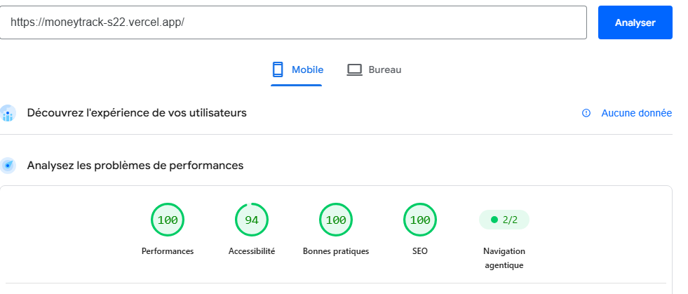

# MoneyTrack — Gestion financière personnelle

**MoneyTrack** est une application web de gestion financière personnelle développée dans le cadre d'un projet académique par le **Groupe 3**.

Elle permet aux utilisateurs de suivre leurs revenus et leurs dépenses, de gérer leurs budgets, de consulter leurs statistiques et de mieux organiser leurs finances.

## Liens du projet

- **Dépôt GitHub :** https://github.com/jorivas021/MoneyTrack-S22
- **Lien live :** https://moneytrack-s22.vercel.app/

## Équipe de développement — Groupe 3

Le groupe est initialement composé de cinq membres. Cependant, seuls trois membres ont effectivement participé au développement et à la réalisation du projet.

### Membres ayant collaboré

| Membre | Fonction | Compte GitHub |
|---|---|---|
| **NSANGOU Djenna** | Team Lead | [@DIASSIVI-sys](https://github.com/DIASSIVI-sys) |
| **BOKITOMO José Gloire** | Repository Admin | [@jorivas021](https://github.com/jorivas021) |
| **IKEKE NKOUMANDO Salomon Prestige** | Développeur Fonctionnalités | [@INSP18](https://github.com/INSP18) |

## Répartition des tâches et organisation du travail

### Répartition initialement prévue

Le cahier technique du projet prévoyait une répartition des responsabilités en cinq tâches principales :

- **Tâche 1 — Team Lead :** Dashboard et gestion des budgets.
- **Tâche 2 — Repository Admin :** Gestion des transactions et administration du dépôt GitHub.
- **Tâche 3 — Développeur Authentification :** Inscription, connexion et profil utilisateur.
- **Tâche 4 — Développeur Rendu & Performance :** Pages publiques, SSG, ISR, SSR et optimisation des performances.
- **Tâche 5 — Développeur Fonctionnalités :** Gestion des catégories, statistiques et historique financier.

### Réorganisation à la suite de l'absence de deux membres

La répartition initiale n'a pas pu être respectée intégralement en raison de l'absence des deux derniers membres initialement prévus pour participer au projet.

Cette situation a entraîné une réorganisation importante du travail. Les trois membres effectivement présents ont dû assurer la réalisation du projet avec un effectif réduit, en reprenant et en couvrant les responsabilités nécessaires qui ne pouvaient plus être assurées par les membres absents.

Cette redistribution a notamment entraîné un élargissement des responsabilités de certains membres, en particulier celles du Repository Admin, qui a également pris en charge plusieurs aspects du développement applicatif.

### Répartition effective des responsabilités

#### 1. NSANGOU Djenna — Team Lead

**Tâche principale : Tâche 1 — Dashboard et Budgets**

Responsabilités :
- Développement du tableau de bord.
- Mise en place des cartes présentant le solde total, les revenus, les dépenses et les dernières transactions.
- Création, modification et suppression des budgets.
- Affichage de la progression des budgets et des alertes de seuil.
- Coordination du travail de l'équipe.
- Suivi de l'avancement et préparation de la démonstration du projet.

#### 2. BOKITOMO José Gloire — Repository Admin

**Tâches prises en charge : Tâches 2, 3 et 4**

En plus de ses responsabilités initiales de gestion du dépôt GitHub et de développement des transactions, il a également assuré une partie importante des travaux liés à l'authentification, au profil utilisateur et aux interfaces publiques.

**Tâche 2 — Repository Admin et gestion des transactions**

Pages responsables :
- Liste des transactions.
- Ajouter une transaction.
- Modifier une transaction.

Responsabilités :
- Développement du CRUD des revenus et des dépenses.
- Création des formulaires et mise en place des validations.
- Consultation, modification et suppression des transactions.
- Mise en place des filtres par date et par type, ainsi que de la recherche.
- Administration du dépôt GitHub.
- Gestion des branches et des règles de collaboration.
- Contrôle des Pull Requests et résolution des conflits.
- Coordination technique du déploiement sur Vercel avec le Team Lead.
- Gestion des variables d'environnement et de la connexion à la base de données.

**Tâche 3 — Authentification et profil utilisateur**

Pages responsables :
- Inscription.
- Connexion.
- Profil utilisateur.

Responsabilités :
- Intégration et configuration d'Auth.js.
- Gestion de la connexion, de la déconnexion et des sessions.
- Protection des pages privées.
- Mise en place des mécanismes de sécurisation des routes.
- Consultation et modification des informations du profil utilisateur.

**Tâche 4 — Rendu et performance**

Pages responsables :
- Accueil.
- Présentation de MoneyTrack.
- Conseils financiers et FAQ.

Responsabilités :
- Développement des pages publiques.
- Mise en place des mécanismes de rendu adaptés aux différentes pages.
- Participation à l'intégration des stratégies SSG, ISR et SSR prévues dans le cahier technique.
- Optimisation de l'affichage et de l'expérience utilisateur.
- Adaptation responsive des interfaces.

#### 3. IKEKE NKOUMANDO Salomon Prestige — Développeur Fonctionnalités

**Tâche principale : Tâche 5 — Catégories et Statistiques**

Pages responsables :
- Gestion des catégories.
- Statistiques et historique.

Responsabilités :
- Création, consultation, modification et suppression des catégories de revenus et de dépenses.
- Association des catégories aux transactions, en coordination avec le membre responsable des transactions.
- Affichage des revenus et dépenses par catégorie.
- Mise en place des comparaisons et des graphiques essentiels.
- Présentation d'un historique et d'un bilan financier sur une période donnée.

## Technologies utilisées

| Technologie | Utilisation |
|---|---|
| Next.js 16 | Framework de développement |
| React 19 | Interface utilisateur |
| TypeScript | Typage du code |
| Tailwind CSS 4 | Mise en forme et responsive design |
| PostgreSQL | Base de données relationnelle |
| Prisma 7 | ORM et gestion des données |
| Auth.js | Authentification |
| bcryptjs | Hachage des mots de passe |
| Vercel | Hébergement et déploiement |

## Fonctionnalités principales

- Inscription et connexion des utilisateurs.
- Protection des espaces privés.
- Gestion du profil utilisateur.
- Gestion des revenus et des dépenses.
- Gestion des catégories financières.
- Création et suivi des budgets.
- Tableau de bord financier.
- Statistiques et historique des opérations.
- Conseils financiers.
- Interface responsive.

## Installation du projet

### Prérequis

- Node.js
- npm
- PostgreSQL

### 1. Cloner le dépôt

```bash
git clone https://github.com/jorivas021/MoneyTrack-S22.git
cd MoneyTrack-S22/moneytrack
```

### 2. Installer les dépendances

```bash
npm install
```

### 3. Configurer les variables d'environnement

Créer un fichier `.env` à partir du fichier `.env.example`, s'il est disponible :

```bash
cp .env.example .env
```

Renseigner les informations nécessaires à la connexion PostgreSQL et à l'authentification.

**Important :** Ne jamais publier les identifiants de connexion ou les secrets dans le dépôt GitHub.

### 4. Démarrer l'application

```bash
npm run dev
```

L'application sera accessible sur :

http://localhost:3000

### 5. Vérifier la compilation

```bash
npm run build
```

## Organisation du dépôt GitHub

Le développement est organisé autour d'un workflow Git basé sur les issues et les Pull Requests.

Les étapes adoptées sont les suivantes :

1. Création d'une issue pour identifier une tâche.
2. Création d'une branche dédiée.
3. Développement de la fonctionnalité ou de la correction.
4. Vérification du fonctionnement et compilation locale.
5. Envoi des modifications sur GitHub.
6. Création d'une Pull Request vers la branche `develop`.
7. Vérification et fusion des modifications.

La branche `develop` sert de branche d'intégration avant la mise à jour de la branche principale.

## Déploiement

MoneyTrack est déployé sur **Vercel** et utilise une base de données PostgreSQL configurée pour l'environnement de production.

**Lien live :** https://moneytrack-s22.vercel.app/


## Performances mobiles

MoneyTrack a été évalué avec Google PageSpeed Insights sur mobile.

| Indicateur | Résultat |
|---|---:|
| Score de performance mobile | **100/100** |
| Score d'Accessibilité | **94/100** |
| Score minimum exigé | 80/100 |
| Objectif atteint | Oui |

Le projet dépasse largement le seuil minimum de performance demandé.

### Capture du résultat



**Outil :** [Google PageSpeed Insights](https://pagespeed.web.dev/)

**Site testé :** [MoneyTrack](https://moneytrack-s22.vercel.app/)


## Statut du projet

Le projet dispose de ses principales fonctionnalités de gestion financière, de son système d'authentification, de ses interfaces publiques et privées ainsi que de son environnement de déploiement.

Malgré les difficultés organisationnelles rencontrées, notamment l'absence de deux membres initialement prévus dans l'équipe, les trois membres ayant effectivement collaboré ont assuré la continuité du développement et la réalisation des différentes parties du projet.

Cette expérience a nécessité une adaptation de la répartition initiale des tâches, une prise en charge élargie des responsabilités et une collaboration renforcée entre les membres actifs.

---

**MoneyTrack — Prenez le contrôle de vos finances.**

**Projet réalisé par le Groupe 3.**
